# CHIP8_FPGA_ZyboZ7

A cycle-accurate, physical implementation of the CHIP-8 virtual machine instruction set synthesized in **SystemVerilog** for the Digilent Zybo Z7 (Zynq-7000) FPGA.

---

## 🎯 Project Overview
Unlike traditional software emulators, this project implements a dedicated hardware CPU datapath and control unit directly in silicon to execute classic CHIP-8 binaries without an underlying OS or microcoded processor.

* **Target Device:** Digilent Zybo Z7-20 / Z7-10 (Xilinx Zynq-7000)
* **HDL:** SystemVerilog (IEEE 1800-2012)
* **Toolchain:** AMD/Xilinx Vivado ML

---

## 🧱 Architecture & Modules
- **Clock Divider & Enable:** Generates the ~600 Hz CPU tick and 60 Hz timer ticks from the 125 MHz board clock.
- **Memory (RAM 4 KB):** Single-cycle synchronous RAM preloaded with fontset and ROM using `$readmemh`.
- **Register File & Stack:** 16x 8-bit general registers (`V0`-`VF`), 16-bit `PC`, 12-bit index register `I`, and a 16-level call stack.
- **ALU:** Purely combinational arithmetic and logic unit handling `8xy0` through `8xyE` opcodes with carry/borrow flag support.
- **Control Unit (FSM):** Multi-cycle state machine implementing standard `FETCH -> DECODE -> EXECUTE` stages.
- **Draw Engine & Framebuffer:** 64x32 monochrome display engine with XOR pixel toggling and `VF` collision detection.
- **Peripherals:** Delay and Sound timers (60 Hz countdown) and video output controller.

---

## 🗺️ Roadmap & Milestones
- [ ] Setup repository structure and Vivado template project
- [ ] Design and test **ALU** combinational module (`8xy0`–`8xyE`) in Vivado simulator
- [ ] Implement **Register File** (`V0`-`VF`, `I`, `PC`) and hardware **Stack**
- [ ] Implement 4 KB **RAM** with `$readmemh` ROM initialization
- [ ] Build multi-cycle **Control Unit FSM**
- [ ] Verify core execution with the *Timendus CHIP-8 Test Suite*
- [ ] Implement 64x32 monochrome **Framebuffer** and display output
- [ ] Connect input keys and audio/timers

---

## 🧮 ALU (Arithmetic Logic Unit)

An ALU is used for purely combinational arithmetic and logic. CHIP-8's ALU handles the '8xyN' family of opcodes.
All of the instructions this ALU is capable of executing are as follows:

| Opcode | Instruction | Description |
| :---: | :--- | :--- |
| `8xy0` | **ASSIGN** | Assigns the value of `Vy` directly to `Vx` (`Vx = Vy`). |
| `8xy1` | **OR** | Performs a bitwise OR operation on the values of `Vx` and `Vy`, and stores the result in `Vx` (`Vx = Vx | Vy`). |
| `8xy2` | **AND** | Performs a bitwise AND operation on the values of `Vx` and `Vy`, and stores the result in `Vx` (`Vx = Vx & Vy`). |
| `8xy3` | **XOR** | Performs a bitwise exclusive OR (XOR) on the values of `Vx` and `Vy`, and stores the result in `Vx` (`Vx = Vx ^ Vy`). |
| `8xy4` | **ADD** | Adds `Vx` to `Vy` (`Vx = Vx + Vy`)[cite: 1]. The state flag `VF` is set to `1` if the result exceeds 255 (a carry occurs), otherwise it is set to `0`. |
| `8xy5` | **SUB** | Subtracts `Vy` from `Vx` (`Vx = Vx - Vy`)[cite: 1]. The `VF` flag follows a *NOT borrow* rule: it is set to `1` if `Vx >= Vy` (no borrow), and `0` if `Vx < Vy` (borrow). |
| `8xy6` | **SHR** | Shifts the bits of `Vx` one position to the right (`Vx = Vx >> 1`)[cite: 1]. The bit that is shifted out is stored directly in the `VF` flag. |
| `8xy7` | **SUBN** | Inverse subtraction. Subtracts `Vx` from `Vy` (`Vx = Vy - Vx`). The `VF` flag follows the *NOT borrow* rule: it is set to `1` if `Vy >= Vx` (no borrow), and `0` if `Vy < Vx` (borrow). |
| `8xyE` | **SHL** | Shifts the bits of `Vx` one position to the left (`Vx = Vx << 1`)[cite: 1]. The bit that is shifted out is stored directly in the `VF` flag. |

